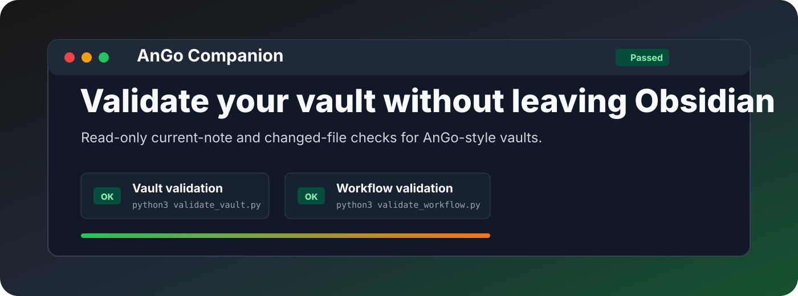
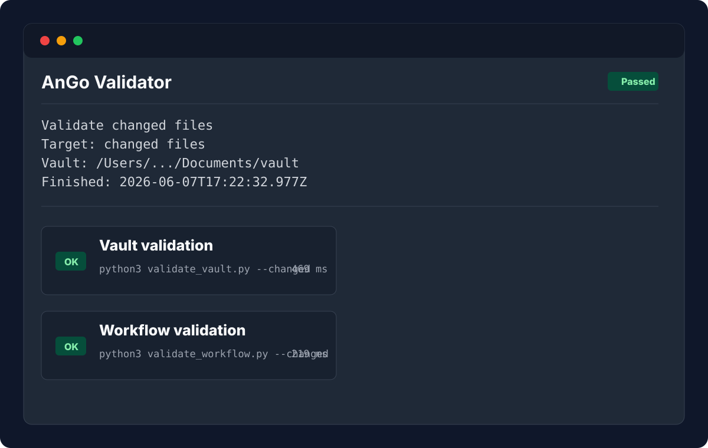

> **Deprecated — 13 November 2026.** AnGo Companion is no longer actively maintained or intended for new installations. It depends on legacy private validators that a standard vault does not contain. Version 1.0.2 remains available for existing users; it has not been submitted to the Community catalog.
>
> A ViggObsidian plugin is being developed as the successor, using shared Rust validation rules locally inside Obsidian. Its link-style WASM feasibility proof is complete ([ViggObsidian PR #67](https://github.com/viggomeesters/viggobsidian/pull/67)); the successor is not yet a published plugin. Migration instructions will follow when it is available. This repository remains accessible during that transition.

<p align="center">
  
</p>

<p align="center">
  <a href="https://github.com/viggomeesters/obsidian-ango-companion/releases/latest"></a>
  <a href="LICENSE"></a>
  
  
  
</p>

# AnGo Companion

AnGo Companion is a desktop-only Obsidian plugin that runs local vault validation commands from inside Obsidian and displays the result in a dedicated side pane. It is built for Life OS / AnGo-style vaults that already include the validation scripts.



## Legacy features

- Adds `AnGo: Validate current note`.
- Adds `AnGo: Validate changed files`.
- Adds `AnGo: Validate current note and AnGo context`.
- Adds `AnGo: Validate current folder`.
- Adds `AnGo: Validate vault`.
- Adds `AnGo: Open control surface`.
- Runs the existing vault validators from the configured vault root.
- Shows a read-only control surface for vault root, Python command, AnGo context, schema, workflow contract, and validator readiness.
- Shows command status, duration, stdout, stderr, and failure details in an Obsidian view.
- Summarizes validation runs with error/warning counts, failed validators, highlighted findings, copy buttons, and links to referenced vault files when they can be resolved safely.
- Shows a status bar indicator for the latest run and keeps a short in-memory session history.
- Optionally validates Markdown notes after save with a debounce.
- Remembers the last validation run so reopening the pane keeps useful context available.
- Opens the AnGo context note and schema from commands.
- Stays read-only: it does not create, modify, fix, stage, or commit vault files.

## Requirements

AnGo Companion runs on desktop Obsidian because it spawns local Python processes. It does not bundle AnGo validators; it calls the validators that already live in your vault.

AnGo Companion expects these scripts to exist in the target vault:

```text
system/scripts/vault/validate_vault.py
system/scripts/vault/validate_vault_workflow.py
```

The plugin runs:

```bash
python3 system/scripts/vault/validate_vault.py <target>
python3 system/scripts/vault/validate_vault_workflow.py <target>
```

For changed-file validation, `<target>` is `--changed`. For current-note validation, `<target>` is the active Markdown file path.

## Privacy

AnGo Companion does not make network requests and does not send vault content to external services. Validation happens locally by spawning the configured Python command from the configured vault root.

## Existing installations

New installations are discouraged. Existing releases and their settings remain unchanged; the instructions below are retained for existing users, not a supported new deployment route. Do not remove your current setup on the assumption that the successor is already available.

### Community plugin directory

AnGo Companion is not in the Community catalog and will not be submitted in its deprecated form.

### Manual installation

For an existing legacy environment with the required validators:

1. Download `main.js`, `manifest.json`, and `styles.css` from the [latest release](https://github.com/viggomeesters/obsidian-ango-companion/releases/latest).
2. Create this folder in your vault: `.obsidian/plugins/ango-companion/`.
3. Put the downloaded files in that folder.
4. Reload Obsidian.
5. Enable **AnGo Companion** in **Settings -> Community plugins**.

### BRAT installation

For beta testing, install the plugin with [BRAT](https://github.com/TfTHacker/obsidian42-brat) using this repository URL:

```text
https://github.com/viggomeesters/obsidian-ango-companion
```

## Settings

- **Python command**: defaults to `python3`.
- **Vault root override**: optional. Leave empty to use the current Obsidian vault path.
- **Validate on save**: disabled by default. When enabled, saved Markdown notes are validated after a short debounce.
- **Remember last validation run**: enabled by default. Stores the last local validation output in the plugin's Obsidian data so the pane can restore it after reopening.

If Obsidian cannot expose the current vault path on your platform, set **Vault root override** to the absolute path of the AnGo-style vault that contains `system/scripts/vault/validate_vault.py` and `system/scripts/vault/validate_vault_workflow.py`.

## Troubleshooting

- **Missing script**: confirm that the configured vault root contains both required validator scripts under `system/scripts/vault/`.
- **Python command not found**: set **Python command** to the full path of your Python executable.
- **Wrong vault**: set **Vault root override** when the validators should run against a different vault than the one currently open in Obsidian.
- **Validation fails**: inspect the output pane. The plugin shows the exact command, duration, stdout, stderr, and exit status so the same command can be reproduced in a terminal.
- **Vault validation is slow**: full-vault validation can take substantially longer than note, folder, or changed-file validation on large vaults.
- **Sensitive output**: disable **Remember last validation run** if validator output may contain details you do not want stored in plugin data.

## Development

```bash
npm install
npm run build
npm run typecheck
OBSIDIAN_VAULT_ROOT="/path/to/your/vault" npm run install:vault
```

For local development, run `npm run build` and set `OBSIDIAN_VAULT_ROOT` when running `npm run install:vault`. The install script copies the release assets into `.obsidian/plugins/ango-companion/` inside that vault.

## Historical release process

No further AnGo feature releases or Community submission are planned. The steps below document the existing release format.

Obsidian installs community plugin files from GitHub releases. For each release:

1. Update `manifest.json`, `package.json`, and `versions.json`.
2. Run `npm install`, `npm run build`, and `npm run typecheck`.
3. Create a GitHub release whose tag exactly matches `manifest.json.version`.
4. Attach `main.js`, `manifest.json`, and `styles.css` as release assets.

## Successor and support status

[Issue #1](https://github.com/viggomeesters/obsidian-ango-companion/issues/1) records the deprecation decision and successor transition. The existing plugin is not automatically replaced. The ViggObsidian successor needs its own plugin interface, review, runtime testing and release/catalog acceptance before migration can be recommended.

## License

[MIT](LICENSE)
